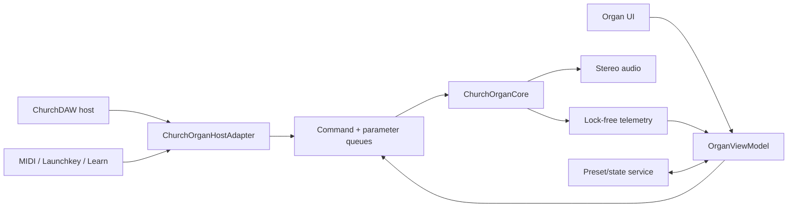

# Church Organ Engine — Arquitetura

Status: contrato de arquitetura para implementação futura, sem integração no produto.

Escopo deste documento: núcleo DSP original, adaptadores de plataforma e UI, contrato de tempo real, estado, presets, qualidade, diagnóstico e gates de entrega para Windows, macOS e Android.

## 1. Objetivo

O Church Organ Engine será um instrumento nativo do ChurchDAW com quatro famílias sonoras:

1. `tonewheel`: órgão eletromecânico com drawbars, foldback, contatos, leakage, percussão, scanner e rotary speaker;
2. `transistor`: órgão eletrônico compacto, mais direto e brilhante;
3. `pipe`: órgão de tubos por síntese híbrida, com divisões, registros e ambiente;
4. `worshipHybrid`: núcleo de órgão combinado com camada atmosférica e macro de intensidade.

O produto deve soar expressivo em culto ao vivo, responder sem latência perceptível, manter estado previsível e escalar de Android econômico a desktop de alta qualidade.

## 2. Restrições obrigatórias

- Implementação clean-room, original e documentada.
- Nenhum código, tabela, preset, impulso, amostra, arte ou nome de preset de concorrente.
- Nenhuma dependência da UI dentro do núcleo DSP.
- Nenhuma alocação, espera, lock, acesso a disco, log textual ou chamada de rede na thread de áudio.
- Todos os tamanhos máximos usados no áudio são definidos ou reservados em `prepare`.
- Parâmetros contínuos são suavizados; mudanças estruturais usam transição segura.
- Estado serializado usa IDs estáveis e versão explícita.
- O mesmo núcleo C++ atende Windows, macOS e Android.
- Adaptadores futuros de plugin podem reutilizar o núcleo sem depender do aplicativo standalone.

## 3. Limites do sistema



### 3.1 Núcleo

`ChurchOrganCore` conhece somente:

- especificação de áudio;
- eventos MIDI normalizados;
- snapshot de parâmetros;
- buffers de áudio;
- comandos de mudança estrutural já preparados;
- estruturas de telemetria triviais e limitadas.

Ele não conhece:

- `Component`, widgets ou layout;
- caminhos de arquivo;
- licença, catálogo ou download;
- diálogo, janela ou sistema operacional;
- dispositivo MIDI concreto;
- formato de preset em disco;
- plugin host;
- strings localizadas.

### 3.2 Adaptadores

`ChurchOrganHostAdapter` será responsável por:

- converter MIDI JUCE para o formato compacto do núcleo;
- converter parâmetros do ChurchDAW em snapshots;
- preparar e resetar o núcleo;
- rotear áudio e fazer bypass/crossfade;
- expor estado e telemetria ao host;
- aplicar migrações de estados antigos.

`OrganViewModel` será responsável por:

- transformar estado do motor em dados de apresentação;
- validar e limitar comandos da UI;
- produzir rótulos, valores formatados e estados de acessibilidade;
- nunca ler memória mutável do áudio sem snapshot/atômicos.

Adaptadores de plataforma ficam fora do núcleo:

- `DesktopOrganAdapter`: integração Windows/macOS;
- `AndroidOrganAdapter`: lifecycle, suspensão, retomada e limites móveis;
- `PluginOrganAdapter`: reservado para formatos de plugin futuros.

## 4. Organização proposta

Esta estrutura é uma proposta de ownership, não uma autorização para integração durante o freeze:

```text
Source/
  OrganEngineCore/
    ChurchOrganCore.h
    ChurchOrganCore.cpp
    OrganTypes.h
    OrganParameters.h
    OrganState.h
    VoiceAllocator.h
    KeyContactModel.h
    TonewheelBank.h
    HarmonicFoldback.h
    DrawbarMixer.h
    TonewheelCharacter.h
    PercussionEngine.h
    ScannerModulator.h
    TransistorEngine.h
    PipeOrganEngine.h
    WorshipLayer.h
    OrganAutoMix.h
    OrganDrive.h
    RotaryCabinet.h
    ParameterSmoothers.h
    PresetTransition.h
    RealtimeDiagnostics.h
  OrganEngineAdapters/
    ChurchOrganHostAdapter.h
    ChurchOrganHostAdapter.cpp
    OrganViewModel.h
    OrganViewModel.cpp
  OrganEngineUI/
    OrganPanel.h
    OrganPanel.cpp
```

O núcleo pode começar header/source puro em diretório isolado. Adaptadores e UI só entram depois do freeze e sob ownership único.

## 5. Contrato público do núcleo

A API pública deve permanecer pequena. A forma abaixo é conceitual:

```cpp
namespace churchdaw::organ
{
struct ProcessSpec
{
    double sampleRate;
    int maximumBlockSize;
    int outputChannels;
    QualityProfile quality;
};

struct RenderBlock
{
    float* left;
    float* right;
    int numSamples;
    EventSpan events;
    const ParameterSnapshot* parameters;
};

class ChurchOrganCore
{
public:
    bool prepare (const ProcessSpec&);
    void reset() noexcept;
    void process (const RenderBlock&) noexcept;
    void releaseResources() noexcept;
    EngineTelemetry readTelemetry() const noexcept;
};
}
```

Regras:

- `prepare` roda fora da thread de áudio e pode falhar de maneira explícita.
- `process` é `noexcept`, limitado e não toma ownership externo.
- buffers inválidos, parâmetros não finitos e eventos fora de faixa são tratados defensivamente.
- `ParameterSnapshot` é imutável durante o bloco.
- eventos possuem capacidade máxima conhecida; excedentes geram contador, nunca alocação.
- telemetria é numérica e copiada por snapshot; formatação em texto ocorre fora do áudio.

## 6. Fluxo de sinal

### 6.1 Entrada comum

```text
MIDI normalizado
  -> ordenação estável por sample offset
  -> roteamento de manual/pedal/split
  -> KeyContactModel
  -> VoiceAllocator
  -> mecanismo da família selecionada
```

Eventos suportados no primeiro release:

- note on/off;
- sustain;
- expression;
- pitch bend quando a família permitir;
- mod wheel;
- aftertouch/canal quando mapeado;
- velocidade do rotary speaker;
- preset program change opcional;
- panic/all notes off;
- parâmetros aprendidos por MIDI.

### 6.2 Tonewheel

```text
TonewheelBank
  -> HarmonicFoldback
  -> KeyContactModel
  -> DrawbarMixer
  -> Leakage + crosstalk
  -> Key click
  -> Percussion
  -> Scanner chorus/vibrato
  -> Transformer / preamp character
  -> OrganDrive
  -> RotaryCabinet
  -> OrganAutoMix
```

Perfis de caráter originais:

- `clean`: estabilidade, baixo leakage e resposta direta;
- `aged`: deriva moderada, leakage e assimetria controladas;
- `road`: ataque mais evidente, saturação mais firme e ruído ainda musical.

Cada perfil altera coeficientes internos, nunca troca o contrato externo.

### 6.3 Transistor

```text
Oscillator rank set
  -> divider/registration model
  -> bright filters
  -> key transient
  -> transistor nonlinearity
  -> optional scanner
  -> rotary or direct cabinet
```

O motor deve preservar a resposta rápida e a soma mais rígida dessa família sem reutilizar a modelagem tonewheel como simples preset.

### 6.4 Pipe

```text
Division + stop routing
  -> pipe excitation
  -> resonator/rank model
  -> chiff/transient
  -> wind interaction
  -> stereo placement
  -> room/early reflections
```

Requisitos:

- divisões e registros com limites de polifonia independentes;
- comportamento coerente em nota sustentada;
- ambiente desacoplado do gerador;
- nenhuma biblioteca externa obrigatória no release inicial;
- registros originais e genéricos, sem nomes proprietários.

### 6.5 Worship Hybrid

```text
Selected organ family
  + tonal support layer
  + shimmer/air layer
  + width/modulation
  -> Worship Intensity macro
  -> OrganAutoMix
```

`Worship Intensity` não é apenas volume. A macro controla uma curva coordenada de:

- presença da camada;
- abertura espectral;
- densidade/modulação;
- send de ambiente;
- largura;
- compressão/controle de pico;
- compensação de ganho para evitar salto de loudness.

Cada destino recebe curva e limite próprios. A macro deve ser monotônica perceptualmente e testável.

## 7. Módulos DSP

### 7.1 `VoiceAllocator`

- pools limitados por manual, pedal e família;
- política de roubo determinística;
- prioridade para ataques novos sem cortar desnecessariamente baixos sustentados;
- contadores de steal e overflow;
- nenhum container que cresça durante `process`;
- reset completo em panic, troca estrutural e mudança de sample rate.

### 7.2 `KeyContactModel`

- múltiplos contatos com offsets temporais pequenos e determinísticos;
- humanização opcional, seed persistido e reprodução determinística;
- release contact separado;
- velocidade influencia intensidade, não a afinação;
- modo econômico pode agrupar contatos preservando o envelope percebido.

### 7.3 `TonewheelBank`

- geradores compartilhados por frequência, não um oscilador completo por voz;
- fase contínua;
- perfis de estabilidade e envelhecimento;
- soma com headroom documentado;
- proteção contra aliasing nas harmônicas altas;
- estado totalmente preparado antes da ativação.

### 7.4 `HarmonicFoldback`

- tabela própria, gerada e validada por faixa;
- comportamento separado para grave e agudo;
- invariantes de monotonicidade e limites de índice;
- cobertura completa das 128 notas MIDI mesmo que a faixa musical seja menor.

### 7.5 `DrawbarMixer`

- nove drawbars por manual no escopo inicial;
- passos de `0..8` com interpolação suave quando automatizados;
- ganhos em domínio perceptual calibrado;
- normalização que preserva caráter sem mascarar combinações fortes;
- suporte futuro a dois manuais sem alterar IDs existentes.

### 7.6 `PercussionEngine`

- segundo/terceiro harmônico conforme configuração;
- decay e volume selecionáveis;
- regra de retrigger configurável por legato;
- cancelamento/queda coerente com contatos;
- sem mudança abrupta de ganho do drawbar relacionado.

### 7.7 `ScannerModulator`

- chorus e vibrato com posições discretas;
- delay modulado com leitura fracionária;
- mudança de modo com crossfade;
- fase e profundidade coerentes;
- perfil Eco pode reduzir taps, nunca introduzir clique.

### 7.8 `OrganDrive`

- estágios separados para transformer, preamp e power/cabinet character;
- oversampling escolhido pelo perfil de qualidade;
- mudança de fator somente fora do caminho ativo ou por engine swap;
- DC blocker e proteção contra valores não finitos;
- compensação de ganho aproximada e limitador de segurança no adaptador/host.

### 7.9 `RotaryCabinet`

- rotor grave e horn agudo independentes;
- aceleração e desaceleração assimétricas;
- crossover coerente;
- Doppler, amplitude, posição estéreo e distância de microfone relacionados pela mesma geometria;
- estados `slow`, `stop` e `fast`;
- mix/bypass sem resíduo antigo;
- layout de microfones, distância, room e balance com smoothing;
- avanço de movimento durante silêncio sem custo desnecessário.

O módulo existente `ChannelRotarySpeaker` deve ser tratado como implementação legada até a etapa formal de migração. Não deve ser alterado em paralelo.

### 7.10 `OrganAutoMix`

Recebe métricas limitadas do motor e ajusta apenas ganhos lentos:

- headroom por quantidade de vozes;
- compensação do Worship layer;
- contenção de low-mid em combinações densas;
- estabilidade entre bypass e ativo;
- nenhuma análise que aloque ou bloqueie;
- limites explícitos para não “mixar sozinho” de forma imprevisível.

## 8. Modelo de parâmetros

IDs são minúsculos, estáveis, com namespace e sem rótulos localizados:

```text
organ.family
organ.quality
organ.master.gain
organ.expression
organ.tonewheel.profile
organ.drawbar.upper.16
organ.drawbar.upper.5_1_3
organ.drawbar.upper.8
organ.drawbar.upper.4
organ.drawbar.upper.2_2_3
organ.drawbar.upper.2
organ.drawbar.upper.1_3_5
organ.drawbar.upper.1_1_3
organ.drawbar.upper.1
organ.percussion.enabled
organ.percussion.harmonic
organ.percussion.decay
organ.scanner.mode
organ.drive.amount
organ.rotary.mode
organ.rotary.mix
organ.rotary.micDistance
organ.rotary.stereoWidth
organ.worship.intensity
organ.reverb.amount
```

Regras:

- IDs nunca são reutilizados com outro significado.
- UI labels podem mudar; IDs não.
- valores persistidos são normalizados ou possuem unidade declarada.
- todo parâmetro tem mínimo, máximo, default, curva e tempo de smoothing.
- parâmetros estruturais são marcados como `discrete` e não mudam diretamente estruturas ativas.

## 9. Estado e presets

### 9.1 Envelope de estado

Formato conceitual:

```json
{
  "schema": "churchdaw.organ-state",
  "version": 1,
  "engineRevision": "1.0",
  "family": "tonewheel",
  "preset": {
    "id": "churchdaw.factory.open-worship",
    "name": "Open Worship",
    "category": "Worship",
    "factory": true
  },
  "parameters": {
    "organ.expression": 0.82,
    "organ.drawbar.upper.16": 6,
    "organ.drawbar.upper.5_1_3": 0,
    "organ.drawbar.upper.8": 8,
    "organ.rotary.mode": "slow",
    "organ.worship.intensity": 0.35
  },
  "midi": {
    "manual": "upper",
    "channel": 1
  },
  "extensions": {}
}
```

O JSON é ilustrativo. A persistência real pode usar `ValueTree`/binário do ChurchDAW, desde que preserve o mesmo contrato lógico.

### 9.2 Regras de leitura

- rejeitar envelope com `schema` errado;
- migrar versões conhecidas em sequência;
- manter defaults para campos ausentes;
- ignorar campos futuros desconhecidos;
- limitar números fora da faixa;
- substituir NaN/infinito por default;
- limitar tamanho e profundidade antes de materializar estado;
- nunca desserializar na thread de áudio.

### 9.3 Presets

Tipos:

- factory: somente leitura e versionados junto ao aplicativo;
- user: editáveis e exportáveis;
- session: snapshot embutido no projeto;
- migrated: estado antigo convertido, marcado para nova gravação.

Cada preset contém somente parâmetros e metadados. Recursos pesados são referenciados por ID validado, não por caminho arbitrário.

### 9.4 Troca de preset

1. validar e normalizar fora do áudio;
2. construir `PreparedState`;
3. publicar comando de swap;
4. iniciar crossfade de duração limitada;
5. deixar a instância anterior terminar release ou silenciar dentro do orçamento;
6. reciclar/destruir fora do callback;
7. atualizar UI somente após confirmação do swap.

Parâmetros simples podem fazer ramp. Mudanças de família, qualidade, oversampling ou topologia exigem instância preparada e swap.

## 10. Contrato de tempo real

### 10.1 Proibido em `process`

- `new`, `delete`, resize, crescimento de `vector`, criação de strings;
- mutex, critical section, semaphore, future ou espera;
- filesystem, rede, logging, preferences ou clipboard;
- descoberta de plugin/dispositivo;
- parsing de JSON/XML;
- chamadas de UI;
- exceções cruzando o callback;
- geração preguiçosa de tabelas;
- mudança de sample rate ou oversampling in-place.

### 10.2 Permitido

- leitura de snapshot imutável;
- atômicos triviais com ordem documentada;
- filas SPSC de capacidade fixa;
- arrays e buffers pré-alocados;
- operações DSP limitadas;
- contadores numéricos;
- troca de ponteiro/índice preparada e sem destruição imediata.

### 10.3 Threads

| Contexto | Responsabilidade |
|---|---|
| Audio | render, eventos, smoothing, contadores RT |
| Message/UI | interação, labels, layout, acessibilidade |
| State worker | serialização, migração e preset I/O |
| Prepare worker | tabelas, oversampling, recursos e engine staging |

O adaptador garante que a instância staging nunca seja visível ao áudio antes de `prepare` concluir.

### 10.4 Eventos

- ordenados por `sampleOffset`;
- note-off precede note-on da mesma nota no mesmo offset quando representa retrigger;
- capacidade máxima por bloco definida no `ProcessSpec`;
- overflow incrementa diagnóstico e aplica política segura;
- panic tem caminho prioritário;
- eventos tardios são limitados ao bloco atual e contabilizados.

### 10.5 Smoothing

Categorias:

- ganho/expression: ramp curta por amostra;
- drawbars: ramp curta sem zipper;
- posição de microfone/width: ramp moderada;
- drive: coeficientes suavizados;
- modo rotary: alvo discreto com inércia física;
- família/quality/oversampling: engine swap.

## 11. Perfis de qualidade

| Recurso | Eco | Standard | Ultra |
|---|---|---|---|
| Plataforma alvo | Android econômico | padrão geral | desktop forte |
| Oversampling drive | 1x/2x seletivo | 2x | 4x quando útil |
| Scanner | taps reduzidos | completo | completo/alta precisão |
| Rotary | geometria essencial | geometria completa | interpolação e room refinados |
| Pipe room | econômico | padrão | alta densidade |
| Worship layer | vozes limitadas | completo | completo com maior densidade |
| Polifonia | conservadora | nominal | ampliada dentro do orçamento |

O perfil nunca muda sozinho no meio de uma apresentação. Uma recomendação automática pode ser exibida, mas a troca exige ação explícita ou política previamente consentida.

## 12. MIDI e controle

- mapeamento MIDI pertence ao adaptador, não ao DSP;
- parâmetros expõem ID estável, tipo e faixa;
- learn evita colisão com Panic, notas e controles reservados;
- Launchkey recebe mapa padrão original, sobrescrevível;
- troca slow/fast deve aceitar botão momentâneo e toggle;
- expression tem curva calibrável e fallback seguro;
- pickup/soft takeover para controles absolutos;
- feedback visual não bloqueia o áudio;
- mappings inválidos são ignorados e diagnosticados.

## 13. Diagnóstico

`EngineTelemetry` deve conter apenas POD limitado:

- vozes ativas e pico;
- voice steals;
- eventos descartados;
- bloco máximo e média exponencial de tempo de render;
- deadline misses observados pelo host;
- valores não finitos sanitizados;
- preset swaps e duração máxima;
- perfil de qualidade ativo;
- estado de overload;
- versão/revisão do motor.

Logs legíveis são gerados fora do áudio a partir desses contadores.

## 14. Milestones e gates

### M0 — Contratos e clean-room

Entregas:

- API do núcleo;
- catálogo de parâmetros;
- esquema de estado;
- inventário de referências próprias;
- harness de teste isolado.

Gate:

- revisão de arquitetura aprovada;
- nenhum arquivo de integração alterado;
- build vazio do harness em Windows/macOS/Android toolchain.

### M1 — Fundação RT

Entregas:

- allocator;
- event routing;
- smoothers;
- snapshots;
- diagnóstico;
- panic/reset.

Gate:

- zero alocação/lock no callback medido;
- testes determinísticos;
- sanitizers limpos;
- 30 minutos sem valor não finito.

### M2 — Tonewheel básico

Entregas:

- bank;
- foldback;
- nove drawbars;
- key contacts;
- click/leakage;
- preset state.

Gate:

- frequência e foldback dentro das tolerâncias da matriz;
- automação sem zipper;
- polifonia alvo sem deadline miss.

### M3 — Character e movimento

Entregas:

- percussão;
- scanner;
- drive;
- rotary cabinet;
- perfis Clean/Aged/Road.

Gate:

- transições sem clique;
- aliasing e DC dentro dos limites;
- aceleração/inércia do rotary verificadas;
- comparação Eco/Standard/Ultra aprovada.

### M4 — Famílias adicionais

Entregas:

- transistor;
- pipe;
- roteamento por família;
- presets originais.

Gate:

- cada família possui identidade mensurável e auditiva;
- nenhum preset depende de recurso ausente;
- mudanças de família são seguras.

### M5 — Worship Hybrid e AutoMix

Entregas:

- layer;
- macro;
- room;
- automix contextual.

Gate:

- macro monotônica;
- loudness controlado;
- zero pumping anormal;
- stress com acordes densos aprovado.

### M6 — Adaptador e UI

Entregas:

- host adapter;
- view model;
- páginas LIVE, DRAWBARS, CHARACTER, ROTARY e WORSHIP;
- MIDI learn e acessibilidade.

Gate:

- integração feita após freeze e por owner único;
- estado antigo migrado;
- Android LIVE sem scroll;
- desktop e mobile aprovados.

### M7 — Release candidate

Entregas:

- matriz completa;
- presets factory;
- documentação;
- telemetria de suporte;
- builds Windows/macOS/Android.

Gate:

- testes de plataforma e endurance aprovados;
- regressões do ChurchDAW aprovadas;
- artefatos reproduzíveis;
- rollback validado;
- checklist clean-room assinado.

## 15. Decisões que precisam ser fechadas antes de M2

- número de manuais expostos no primeiro release;
- polifonia nominal por perfil/plataforma;
- sample rates oficialmente suportados;
- duração padrão de crossfade de preset;
- comportamento exato de percussion retrigger;
- limites do pipe engine inicial;
- se o ambiente Worship reutiliza serviço existente via adaptador ou módulo próprio;
- como o preset aparece no projeto ChurchDAW;
- política de compatibilidade de parâmetros legados do rotary.

Essas decisões devem virar ADRs curtos dentro desta pasta antes de afetarem código.
